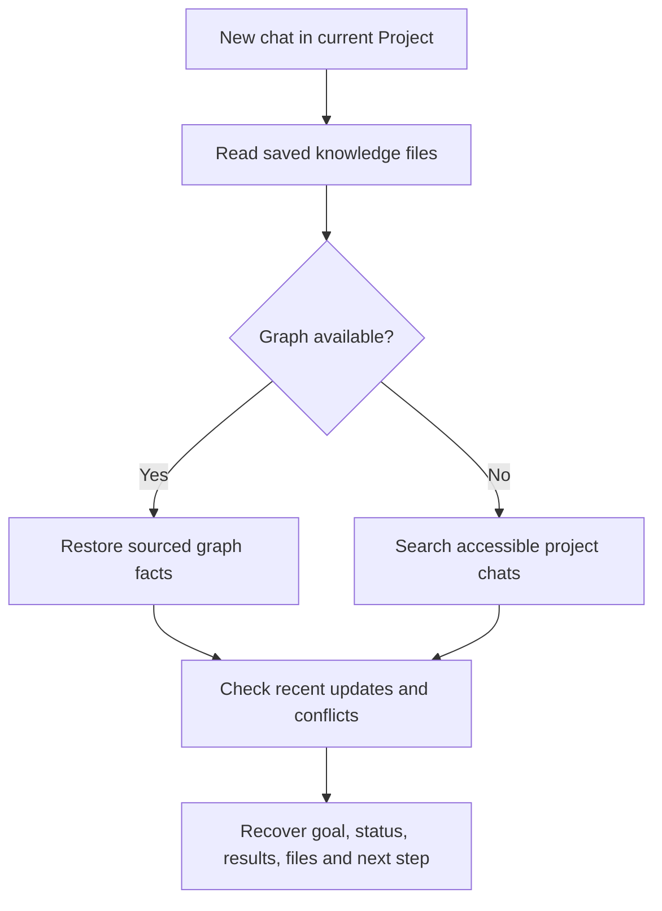

# Project Graphify Reader

**A standalone Claude skill for restoring project context across chats.**

Project Graphify Reader helps Claude pick up a long-running research or
software project in a new chat inside the **same Claude Project**. It reads
saved project knowledge and memory, checks accessible recent conversations
for changes, and reconstructs the most accurate available state.

> **Reader vs. Writer:** This repository contains the standalone **Reader**
> skill only. The separate **Project Graphify** plugin builds and updates
> the knowledge graph. The full plugin also includes this Reader, so you
> should not install it twice.

## Why use it?

When a Claude conversation reaches its context limit, starting a fresh chat
can lose critical details, including:

- Why the project began and what success should look like.
- Which models, modules, and experiments were already implemented or verified.
- Which datasets, seeds, splits, and evaluation procedures must remain fixed.
- Where code files, checkpoints, and logs were reported to be on your machine.
- What results were achieved, which experiments failed, and what remains.

The Reader restores those details while distinguishing observations from
proposals, historical file paths from current filesystem state, and verified
measurements from uncertain reports.

## Features

| Capability | What the Reader does |
| --- | --- |
| Project isolation | Avoids mixing facts from unrelated Claude Projects |
| Goal restoration | Explains why the work exists and the intended outcome |
| Progress recovery | Separates completed milestones from planned steps |
| Results recovery | Preserves exact model, dataset, run, split, seed and metric |
| File/code lookup | Retrieves historical paths, file purposes and dependencies |
| Freshness checks | Identifies results or changes newer than the saved graph |
| Evidence handling | Reports contradictory facts and missing source coverage |
| Safe handoff | Identifies a justified next action without running old commands |

## Installation

### Install as a standalone Claude skill

1. Obtain `project-graphify-reader.zip` from this project's release/download.
2. Check that the ZIP has a **single top-level folder** named
   `project-graphify-reader/` containing `SKILL.md` and `references/`.
3. Upload it using Claude's available custom skill installation feature.
4. Open the Claude Project where you want context recovery.
5. Add the following text to that Project's **Instructions**:

   > At the start of a new chat, use Project Graphify Reader. Read
   > `CONTINUATION.md`, `PROJECT_MEMORY.md`, `GRAPH_REPORT.md`, and relevant
   > parts of `graph.json` from Project Knowledge when accessible. Check
   > newer chats for changes. Restore the project goal, verified results,
   > code paths and purposes, incomplete work, blockers, and the next safe
   > action. State uncertainty and missing source coverage explicitly.

When the complete **Project Graphify** plugin is already installed, you do
not need this standalone installation.

### Start a new chat

Use this prompt:

> Use Project Graphify Reader to recover the available context for this
> Claude Project. Explain its original goal, what has been completed,
> experimental results, historical file paths and purposes, current blockers,
> what remains, and the next safe step. Verify whether the graph is up to date.

For a specific result:

> Find the latest verified result for our baseline reproduction. Separate
> validation and final test, preserve the dataset, seed, and metric definition,
> and explain which chat or log supports each value.

For historical code:

> Find the recorded purpose and location of our evaluation script, scorer,
> checkpoints and training log. Mark whether each path was directly verified
> or merely mentioned in a previous chat.

## Recovery process



If the Writer produced knowledge files, the Reader prioritizes:

1. `CONTINUATION.md` — current status, blockers and next actions.
2. `PROJECT_MEMORY.md` — stable goals and compact context.
3. `GRAPH_REPORT.md` — human-readable inventory.
4. `graph.json` — detailed entities and relationships.
5. `evidence.jsonl` — per-fact provenance.

When those files are missing, it uses Claude's native project-scoped past-chat
search **if enabled and accessible**. This fallback can recover valuable
context, but cannot guarantee every prior chat was retrieved.

## What the Reader returns

It is instructed to give a concise continuation brief with:

```text
Project identity and source coverage
Why the project was started and its current goal
Frozen constraints and important decisions
Verified completed milestones
Results with run/dataset/split/seed/metric/source
Historical file paths, purposes and verification status
Known blockers and remaining work
The next justified safe action
Unknowns, conflicts, and freshness status
```

## Repository layout

```text
project-graphify-reader-skill/
├── README.md
└── project-graphify-reader/
    ├── SKILL.md
    └── references/
        └── reader-evidence.md
```

**Important distinction:** For GitHub, place this `README.md` at the
repository root so visitors see it. For the Claude standalone skill uploader,
ZIP **only** the inner `project-graphify-reader/` folder. The outer repository
folder must not be included in the install ZIP.

## Limitations and security

- This skill **reads/retrieves** the available graph; it does not create a
  full graph from all chats or provide a persistent database by itself.
- The Reader cannot force exhaustive retrieval of old conversations or write
  arbitrary data into hidden Claude memory.
- Project Instructions encourage automatic context recovery but do not
  guarantee a browser-chat startup hook or execution of every skill.
- Historical local paths are not evidence that the files still exist on disk.
- It never treats an assistant-proposed command as proof it ran, and it does
  not automatically restart training, overwrite results or change code.
- Do not publish actual private transcripts, credentials or unpublished
  results on a public GitHub repository.

## Attribution

Project Graphify Reader is a companion skill for the separate **Project
Graphify** plugin. This is an independent adaptation and not an official
Anthropic or Graphify-Labs product. The standalone skill does not include
the original Graphify code engine.
